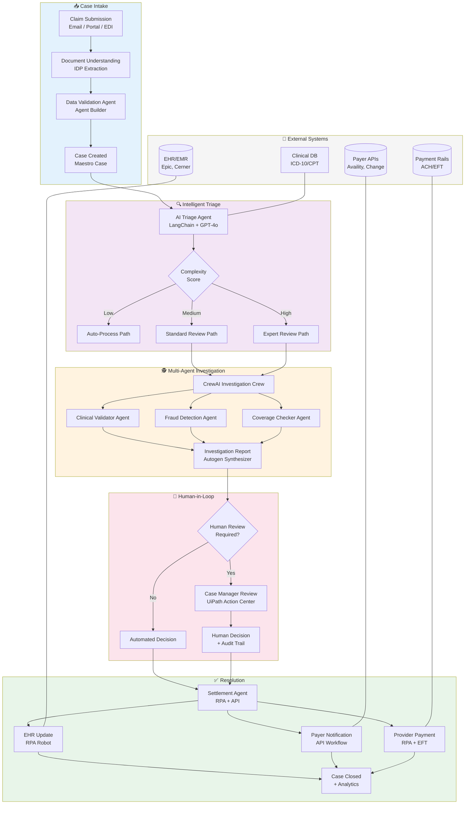

# 🏆 MediClaim Guardian — AI-Powered Healthcare Claims Intelligence

> *Transforming healthcare claims from a 45-day nightmare into a 4-hour intelligent workflow*

[](https://opensource.org/licenses/MIT)
[](https://cloud.uipath.com)
[](https://uipath-agenthack.devpost.com)

---

## 🎯 Problem

Healthcare claims processing is broken. In the United States alone:
- **$1.1 trillion** is wasted annually on administrative inefficiency
- **45+ days** average time to adjudicate a complex insurance claim
- **30%** of claims are initially denied, requiring costly re-submissions
- **Clinicians spend 34%** of their time on administrative tasks instead of patient care
- **Fraud and abuse** cost the US healthcare system $100+ billion annually

The root cause: claims processing is fundamentally a **dynamic, exception-heavy case management problem** — yet most healthcare organizations still handle it with rigid, rules-based workflows that can't adapt to the unexpected.

When a claim involves a rare procedure, conflicting documentation, potential fraud indicators, or a patient mid-treatment plan change, the old systems fail. Cases sit in queues. Patients wait. Providers appeal. Payers over-deny defensively. Everyone loses.

---

## 💡 Solution

**MediClaim Guardian** is an intelligent healthcare claims processing platform built on UiPath Maestro Case management. It orchestrates AI agents, RPA robots, and human reviewers through a dynamic case lifecycle — from first document submission to final settlement.

### What makes it different:
- **AI-first triage** — A LangChain-powered clinical reasoning agent evaluates clinical necessity, ICD codes, and procedure history in seconds
- **Adaptive case stages** — Maestro Case dynamically routes claims based on complexity, risk score, and fraud signals — no two complex cases follow the same path
- **Multi-agent investigation crew** — CrewAI coordinates a team of specialized agents (fraud investigator, clinical validator, coverage checker) that work in parallel
- **Document Understanding** — Extracts structured data from EOBs, medical records, lab reports, and prior auth forms using UiPath IDP
- **Human-in-loop governance** — High-value claims, fraud flags, and clinical edge cases are escalated to human reviewers with full context and AI-generated summaries
- **Self-healing automation** — If an EHR system is down, the case pauses gracefully and resumes with zero data loss

---

## 🏗️ Architecture



### Component Breakdown

| Component | Technology | Responsibility |
|-----------|-----------|----------------|
| Case Orchestrator | UiPath Maestro Case | Dynamic case lifecycle management |
| Document Processor | UiPath Document Understanding | Extract structured data from medical docs |
| Triage Agent | LangChain + GPT-4o | Clinical necessity scoring, complexity assessment |
| Investigation Crew | CrewAI (3 agents) | Parallel fraud, clinical, coverage validation |
| Synthesis Agent | AutoGen | Combine investigation findings into coherent report |
| Human Tasks | UiPath Action Center | Escalation, approval, exception handling |
| EHR Integration | UiPath RPA + SAP Connector | Read/write patient and claim data |
| Payer Integration | UiPath API Workflows | Real-time eligibility and authorization |
| Payment Processing | UiPath RPA | Trigger EFT payment upon approval |

---

## 🚀 Key Features

### 1. Intelligent Document Extraction
- Processes 15+ document types: EOBs, medical records, lab reports, prior auth forms, appeal letters
- OCR + ML classification + LLM semantic extraction
- Confidence scoring flags uncertain extractions for human verification

### 2. AI Clinical Reasoning Agent
- Validates medical necessity using ICD-10/CPT code analysis
- Cross-references clinical guidelines (MCG, InterQual)
- Detects unbundling, upcoding, and fragmentation patterns
- Built with LangChain + custom clinical reasoning tools

### 3. Multi-Agent Fraud Investigation
- **Fraud Investigator Agent:** Checks provider billing patterns, anomaly detection
- **Clinical Validator Agent:** Verifies procedure-diagnosis alignment
- **Coverage Checker Agent:** Validates policy terms, exclusions, deductibles
- Agents run in parallel (CrewAI), converge on a unified investigation report

### 4. Adaptive Case Stages
- **Stage 1:** Intake & Document Processing
- **Stage 2:** AI Triage & Risk Scoring  
- **Stage 3:** Automated or Investigated Review
- **Stage 4:** Human Decision (if required)
- **Stage 5:** Settlement & Notification
- **Exception Paths:** Appeal, Resubmission, Fraud Referral, Duplicate Detection

### 5. Human-in-Loop Control
- Action Center tasks for case managers with AI-generated summaries
- SLA-based escalation (claim approaching deadline auto-escalates)
- Full audit trail for regulatory compliance (HIPAA)
- One-click approve/deny/request-info with reason codes

### 6. Real-Time Analytics Dashboard
- Case throughput, approval rates, denial reasons
- Agent performance metrics
- Fraud detection accuracy
- Average processing time by complexity tier

---

## 🛠️ Tech Stack

| Technology | Purpose | Why Chosen |
|------------|---------|------------|
| **UiPath Maestro Case** | Case lifecycle orchestration | Native dynamic case management, human escalation |
| **UiPath Agent Builder** | Low-code agent creation | Rapid development of data validation agents |
| **UiPath Document Understanding** | Medical document extraction | Best-in-class IDP for healthcare documents |
| **UiPath Action Center** | Human task management | Built-in SLA, audit, approval workflows |
| **UiPath API Workflows** | Payer/EHR integrations | Serverless API connectivity |
| **UiPath RPA** | Legacy EHR/payment systems | Handle systems without APIs |
| **LangChain + GPT-4o** | Clinical reasoning AI | Advanced reasoning with tool calling |
| **CrewAI** | Multi-agent investigation | Parallel agent coordination with role specialization |
| **AutoGen** | Report synthesis | Multi-turn agent collaboration for complex synthesis |
| **Claude Code** | Coded agent development | Bonus: used to build Python coded agents |
| **Python (FastAPI)** | Coded agent backend | RESTful interface for LangChain agents |
| **Azure OpenAI** | LLM provider | Enterprise-grade, HIPAA-eligible |

---

## 📸 Screenshots / Demo

📹 **Demo Video:** [Link to YouTube Demo]

### Case Flow Screenshots
1. Document submission → IDP extraction with confidence scores
2. AI triage dashboard showing complexity scoring
3. CrewAI investigation agents running in parallel
4. Action Center task with AI-generated case summary
5. Case closure with full audit trail and analytics

---

## 🏃 Getting Started

### Prerequisites
- UiPath Automation Cloud account (Labs access)
- Python 3.11+
- Node.js 18+ (for UiPath CLI)
- Azure OpenAI API key (or OpenAI API key)

### Setup Instructions

#### 1. Clone the repository
```bash
git clone https://github.com/your-team/mediclaim-guardian
cd mediclaim-guardian
```

#### 2. Install UiPath CLI (Coding Agent support)
```bash
npm install -g @uipath/cli
uipath auth login
```

#### 3. Configure Python environment
```bash
cd src/agents
pip install -r requirements.txt
cp .env.example .env
# Edit .env with your API keys
```

#### 4. Deploy coded agents to UiPath
```bash
uipath deploy src/agents/clinical_reasoning_agent
uipath deploy src/agents/fraud_detection_agent
uipath deploy src/agents/coverage_checker_agent
```

#### 5. Import Maestro Case definition
- Navigate to UiPath Automation Cloud → Maestro → Cases
- Import `src/maestro/mediclaim-case-definition.json`
- Configure human task queues in Action Center

#### 6. Configure API Workflows
- Import `src/api-workflows/payer-integration.yaml`
- Import `src/api-workflows/ehr-integration.yaml`
- Set connection credentials in Cloud platform

#### 7. Deploy RPA processes
- Publish from Studio: `src/rpa/EHR_DataExtraction.xaml`
- Publish from Studio: `src/rpa/Payment_Processing.xaml`

#### 8. Run end-to-end test
```bash
python tests/e2e_test_claim_flow.py --scenario standard_claim
python tests/e2e_test_claim_flow.py --scenario fraud_scenario
python tests/e2e_test_claim_flow.py --scenario human_escalation
```

---

## 🤖 UiPath Components Used

- ✅ **UiPath Maestro Case** — Core case management and orchestration
- ✅ **UiPath Agent Builder** — Data validation and notification agents
- ✅ **UiPath Document Understanding** — Medical document IDP
- ✅ **UiPath Action Center** — Human-in-loop task management
- ✅ **UiPath API Workflows** — Payer and EHR API integrations
- ✅ **UiPath Automation Cloud Robots** — EHR and payment RPA
- ✅ **UiPath for Coding Agents** — Claude Code used for coded agent development

## 🧠 External Frameworks Used

- ✅ **LangChain** — Clinical reasoning agent with tool calling
- ✅ **CrewAI** — Multi-agent investigation crew (3 specialized agents)
- ✅ **AutoGen** — Investigation report synthesis agent

---

## 👥 Team

| Name | Role |
|------|------|
| Balaji N | Solution Architect & UiPath Developer |

---

## 📄 License

This project is licensed under the MIT License — see the [LICENSE](LICENSE) file for details.
