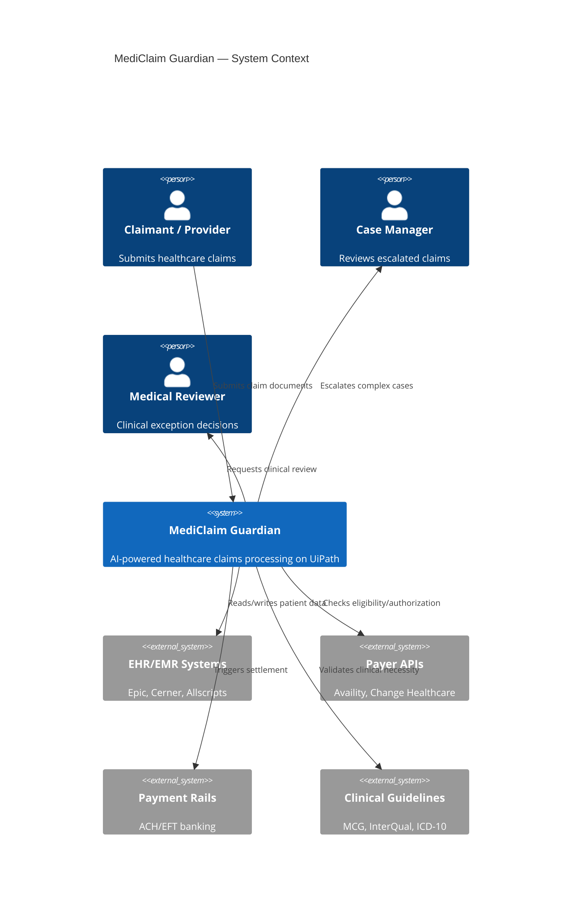
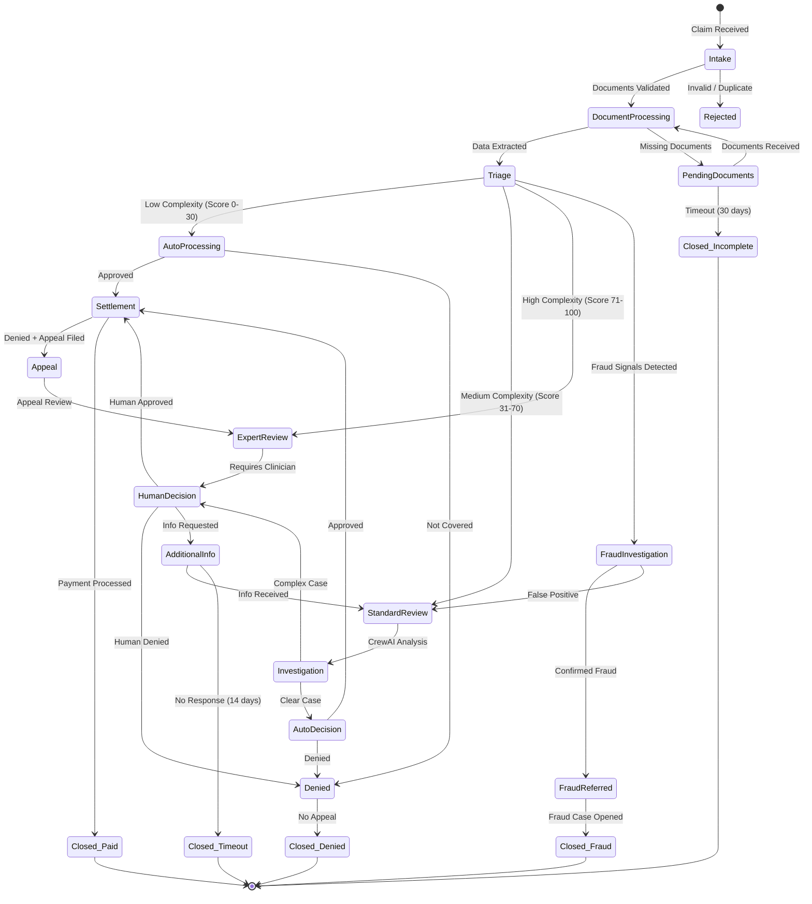
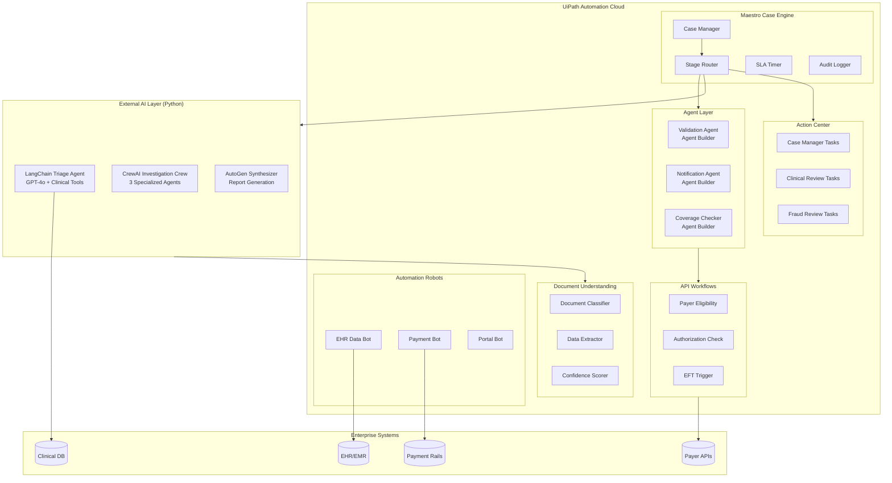
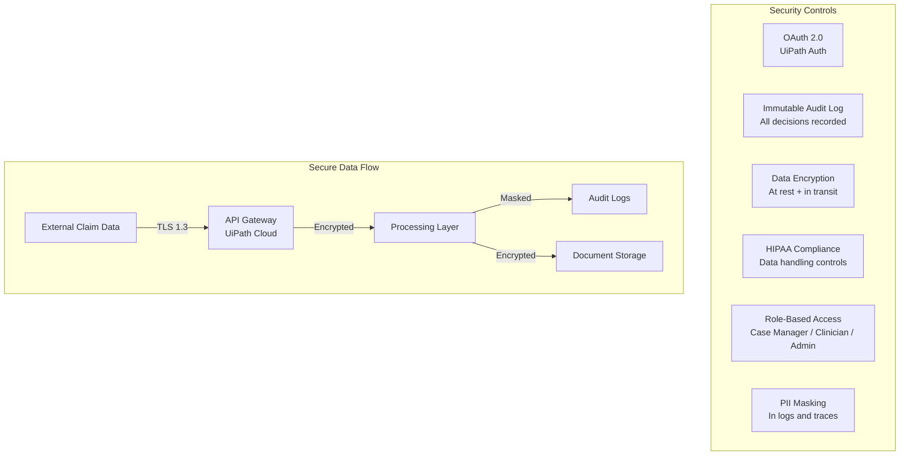

# Architecture — MediClaim Guardian

## System Architecture Overview

MediClaim Guardian uses UiPath Maestro Case as the central orchestration engine, coordinating multiple AI agents, RPA robots, and human reviewers through a dynamic healthcare claims lifecycle.

---

## High-Level Architecture

---

## Maestro Case Stage Flow

---

## Component Architecture

---

## Data Flow

```mermaid
flowchart LR
    A[Claim Submission] --> B{Input Channel}
    B -->|Email| C[Email Trigger\nRPA]
    B -->|Portal| D[Web API\nAPI Workflow]
    B -->|EDI 837| E[EDI Parser\nCoded Agent]

    C & D & E --> F[Document Store\nUiPath Storage]
    F --> G[Document Understanding\nExtract + Classify]
    G --> H[Structured Claim Data\nJSON]

    H --> I[LangChain Triage Agent]
    I --> J[Complexity Score\n+ Risk Flags]
    J --> K[Maestro Case\nCreated + Staged]

    K --> L{Routing}
    L -->|Complex| M[CrewAI Crew\nLaunch]
    L -->|Simple| N[Agent Builder\nAuto-Check]

    M --> O[Investigation Report\nAutoGen]
    N --> O

    O --> P{Decision}
    P -->|Human| Q[Action Center Task\n+ AI Summary]
    P -->|Auto| R[Decision Engine\nRPA]

    Q --> S[Human Decision]
    R --> T[Auto Decision]

    S & T --> U[API Workflow\nSettlement]
    U --> V[EHR Update\nRPA]
    U --> W[Payment\nRPA]
    U --> X[Notification\nAgent Builder]
```

---

## Security Architecture

---

## Technology Stack Justification

| Decision | Rationale |
|----------|-----------|
| **Maestro Case over BPMN** | Claims are dynamic — an appeal path can appear at any stage, fraud investigations emerge mid-process. BPMN's fixed flow can't handle this. |
| **LangChain for triage** | Clinical reasoning requires chain-of-thought, tool calling (ICD-10 lookup, guideline query), and structured output. LangChain excels here. |
| **CrewAI for investigation** | Three independent agents (fraud, clinical, coverage) can work in parallel and converge — exactly what CrewAI's crew model enables. |
| **AutoGen for synthesis** | Investigation requires a "discussion" between findings to produce a coherent recommendation — AutoGen's conversational model fits perfectly. |
| **Document Understanding** | Medical documents (EOBs, records, prior auth forms) are non-standard. UiPath IDP provides pre-trained models for healthcare documents. |
| **RPA for EHR** | 90% of hospitals use Epic/Cerner — both have proprietary UIs. RPA is the only reliable integration path without expensive HL7 FHIR implementations. |

---

## Scalability Design

- **Horizontal scaling:** Multiple Maestro Case instances handle thousands of simultaneous claims
- **Queue-based routing:** Cases dispatched to available agents via UiPath Orchestrator queues
- **Stateless AI agents:** FastAPI coded agents are containerized and auto-scale
- **Async processing:** Long-running AI tasks use async patterns — Maestro waits for completion without blocking
- **SLA monitoring:** Built-in escalation prevents queue buildup from aging claims
