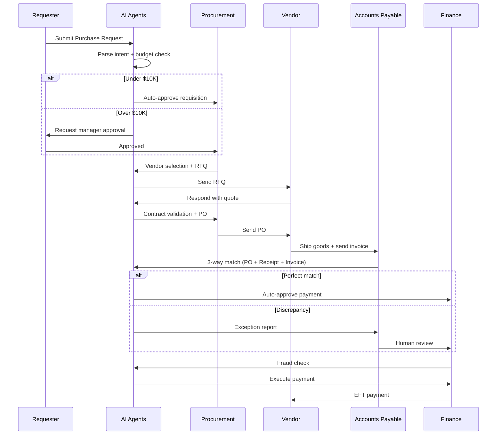

# 🏆 ProcureFlow AI — Intelligent Procure-to-Pay Orchestration

> *From manual PO chaos to AI-governed procurement in one unified BPMN workflow*

[](https://opensource.org/licenses/MIT)
[](https://cloud.uipath.com)
[](https://uipath-agenthack.devpost.com)

---

## 🎯 Problem

Procure-to-Pay (P2P) is a $50 trillion annual process and one of the most universally broken enterprise workflows:

- **65% of invoices** require manual intervention due to mismatches
- **Average 14 days** to process a single invoice — some take 60+
- **$1.2M average** annual cost of invoice fraud per enterprise
- **42% of AP teams** spend most of their time on exceptions, not value-add work
- **ERP data silos** — SAP, Oracle, Coupa, and emails don't talk to each other
- Supplier disputes, contract violations, duplicate payments, and pricing exceptions all handled through email chains and spreadsheets

Existing automation solutions automate single steps (e.g., "read email → enter PO"). They fail at the orchestration layer — when a 3-way match fails, when a vendor's contract expired, or when a budget threshold is exceeded, the process breaks and falls into human queues with no context.

---

## 💡 Solution

**ProcureFlow AI** is an end-to-end Procure-to-Pay workflow modeled in **UiPath Maestro BPMN 2.0**. It coordinates AI agents, RPA robots, human approvers, and enterprise APIs through a structured, auditable process that handles every exception path gracefully.

### What makes it different:
- **Complete BPMN 2.0 model** — Every task, gateway, and lane is explicitly modeled in Maestro BPMN for full process visibility
- **LangChain Requisition Intelligence Agent** — Parses free-text purchase requests, extracts intent, recommends preferred vendors, and flags budget risks
- **AutoGen 3-Way Match Agent** — Reconciles PO, goods receipt, and invoice autonomously, generating a structured exception report only for genuine discrepancies
- **AI Fraud Detection** — Real-time anomaly detection on vendor payment patterns, duplicate invoice detection, split-purchase detection
- **Budget Intelligence** — Automatic budget threshold routing (under $10K auto-approve, $10K-$100K manager approval, $100K+ VP approval)
- **ERP Integration via RPA** — Handles SAP, Oracle, and legacy systems with no API requirement
- **Contract Compliance Agent** — Validates every PO against active contract terms, pricing schedules, and approved vendor lists

---

## 🏗️ Architecture

```mermaid
graph LR
    subgraph Start["🚀 Process Trigger"]
        A[Purchase Request\nEmail / Portal / Slack] --> B[Requisition Agent\nLangChain]
        B --> C{Budget\nCheck}
        C -->|Under Threshold| D[Auto-Approve]
        C -->|Over Threshold| E[Manager Approval\nAction Center]
    end

    subgraph Procurement["📋 Procurement"]
        D & E --> F[Vendor Selection Agent\nLangChain + Vector DB]
        F --> G[RFQ Generation\nAgent Builder]
        G --> H[Vendor Response\nAPI Workflow]
        H --> I[Contract Validation Agent\nLangChain]
        I --> J[PO Creation\nRPA → SAP/Oracle]
    end

    subgraph Fulfillment["📦 Fulfillment"]
        J --> K[PO Sent to Vendor\nAPI / Email]
        K --> L[Goods Receipt\nWarehouse RPA]
        L --> M[Receipt Confirmation\nAgent Builder]
    end

    subgraph InvoiceProcessing["🧾 Invoice Processing"]
        M --> N[Invoice Received\nDocument Understanding]
        N --> O[3-Way Match Agent\nAutoGen]
        O --> P{Match\nResult}
        P -->|Perfect Match| Q[Auto-Approve Payment]
        P -->|Minor Variance| R[AI Auto-Resolve\nWithin Tolerance]
        P -->|Major Discrepancy| S[AP Review\nAction Center]
    end

    subgraph Payment["💳 Payment"]
        Q & R & S --> T[Fraud Check Agent\nCrewAI]
        T --> U{Fraud\nFlag?}
        U -->|Clean| V[Payment Processing\nRPA + EFT/ACH]
        U -->|Suspicious| W[Finance Investigation\nAction Center]
        V & W --> X[ERP Update\nRPA]
        X --> Y[Vendor Notification\nAPI Workflow]
        Y --> Z[Process Complete\n📊 Analytics]
    end

    subgraph Systems["🔗 Enterprise Systems"]
        AA[(SAP ERP)] --- J
        AA --- X
        BB[(Oracle Financials)] --- J
        CC[(Coupa Procurement)] --- G
        DD[(Vendor Portal\nAPIs)] --- H
    end

    style Start fill:#e8f5e9
    style Procurement fill:#e3f2fd
    style Fulfillment fill:#fff8e1
    style InvoiceProcessing fill:#f3e5f5
    style Payment fill:#fce4ec
    style Systems fill:#f5f5f5
```



### BPMN 2.0 Pool/Lane Structure



---

## 🚀 Key Features

### 1. Intelligent Requisition Parsing
- Natural language purchase requests from email, Slack, or web form
- LangChain agent extracts: item, quantity, budget, urgency, cost center
- Automatically matches to preferred vendor catalog
- Flags off-contract purchases and budget overruns before PO is created

### 2. AI-Powered Vendor Intelligence
- Vector database of approved vendors with performance scores
- Contract terms, pricing schedules, lead times, quality ratings
- Real-time vendor risk scoring (financial health, sanctions screening)
- Recommends best-fit vendor with justification

### 3. Automated 3-Way Match
- Extracts invoice data using UiPath Document Understanding
- Compares PO quantities/prices, goods receipt confirmation, invoice amounts
- Tolerance-based auto-resolution (±2% price variance auto-approved)
- Only genuine exceptions reach human AP reviewers
- Built with AutoGen multi-agent conversation for complex reconciliation

### 4. Intelligent Fraud Detection
- Duplicate invoice detection (same amount, same vendor, different dates)
- Split purchase detection (circumventing approval thresholds)
- Vendor impersonation detection (IBAN/bank account changes)
- Behavioral anomaly detection (unusual payment timing, new vendors)

### 5. Full BPMN Visibility
- Every process step visible in Maestro BPMN dashboard
- Real-time status of each PO in the flow
- SLA monitoring with automated escalation
- Full audit trail for SOX and internal audit compliance

### 6. ERP Integration Without Compromise
- SAP BAPI/RFC integration via UiPath RPA
- Oracle REST API integration via API Workflows
- Coupa integration for procurement catalog
- Zero middleware required

---

## 🛠️ Tech Stack

| Technology | Purpose | Why Chosen |
|------------|---------|------------|
| **UiPath Maestro BPMN** | End-to-end process orchestration | Native BPMN 2.0, handles all lanes/gateways |
| **UiPath Agent Builder** | Notification and validation agents | Rapid development, native Maestro integration |
| **UiPath Document Understanding** | Invoice and PO extraction | Best-in-class IDP for financial documents |
| **UiPath Action Center** | AP review, manager approvals | Built-in SLA, approval workflows |
| **UiPath API Workflows** | Vendor APIs, ERP REST APIs | Serverless, managed connections |
| **UiPath RPA** | SAP, Oracle legacy integration | Handle systems without REST APIs |
| **LangChain + GPT-4o** | Requisition parsing, vendor selection | Tool calling, vector DB retrieval |
| **AutoGen** | 3-Way match reconciliation | Multi-agent conversation for complex logic |
| **CrewAI** | Fraud investigation crew | 3 specialized agents in parallel |
| **Chroma DB** | Vendor knowledge base | Fast vector similarity search |
| **Python FastAPI** | Coded agent backend | REST interface for AI agents |
| **Claude Code** | Coded agent development | Bonus: AI-assisted development |

---

## 📸 Screenshots / Demo

📹 **Demo Video:** [Link to YouTube Demo]

### BPMN Process Screenshots
1. Maestro BPMN editor showing the full P2P process model
2. Requisition agent parsing a natural language purchase request
3. 3-way match exception dashboard
4. Action Center task for AP invoice review
5. Fraud alert with investigation details
6. Analytics: process efficiency metrics

---

## 🏃 Getting Started

### Prerequisites
- UiPath Automation Cloud account (Labs access)
- Python 3.11+
- Node.js 18+
- SAP or Oracle test environment (or use provided mock)
- OpenAI API key

### Setup Instructions

#### 1. Clone the repository
```bash
git clone https://github.com/your-team/procureflow-ai
cd procureflow-ai
```

#### 2. Install UiPath CLI
```bash
npm install -g @uipath/cli
uipath auth login
```

#### 3. Set up Python agents
```bash
cd src/agents
pip install -r requirements.txt
cp .env.example .env
# Configure: OPENAI_API_KEY, UIPATH_CLOUD_URL, UIPATH_CLIENT_ID, UIPATH_CLIENT_SECRET
```

#### 4. Initialize vendor knowledge base
```bash
python src/agents/setup_vendor_kb.py
```

#### 5. Deploy coded agents
```bash
uipath deploy src/agents/requisition_agent
uipath deploy src/agents/threeway_match_agent
uipath deploy src/agents/fraud_detection_agent
```

#### 6. Import BPMN process
- UiPath Automation Cloud → Maestro → New BPMN Process
- Import `src/maestro/procureflow-bpmn.json`
- Map agent connections and human task queues

#### 7. Configure ERP integration
- Import RPA processes: `src/rpa/SAP_PO_Creation.xaml`, `src/rpa/SAP_GR_Confirmation.xaml`
- Configure API Workflows: `src/api-workflows/oracle-integration.yaml`

#### 8. Run test scenarios
```bash
python tests/test_standard_po_flow.py
python tests/test_invoice_discrepancy.py
python tests/test_fraud_detection.py
python tests/test_budget_threshold_routing.py
```

---

## 🤖 UiPath Components Used

- ✅ **UiPath Maestro BPMN** — Core BPMN 2.0 process model and orchestration
- ✅ **UiPath Agent Builder** — Notification, catalog matching, and status update agents
- ✅ **UiPath Document Understanding** — Invoice and PO data extraction
- ✅ **UiPath Action Center** — Manager approvals, AP review, finance investigation
- ✅ **UiPath API Workflows** — Vendor portal and ERP REST API integrations
- ✅ **UiPath Automation Robots** — SAP/Oracle RPA integration
- ✅ **UiPath for Coding Agents** — Claude Code used to build coded agent components

## 🧠 External Frameworks

- ✅ **LangChain** — Requisition parsing and vendor intelligence agents
- ✅ **AutoGen** — 3-way match reconciliation via multi-agent conversation
- ✅ **CrewAI** — Fraud investigation with 3 specialized agents
- ✅ **Chroma DB** — Vendor knowledge base (vector search)

---

## 👥 Team

| Name | Role |
|------|------|
| [Your Name] | Solution Architect & UiPath Developer |

---

## 📄 License

MIT License — see [LICENSE](LICENSE) file.
