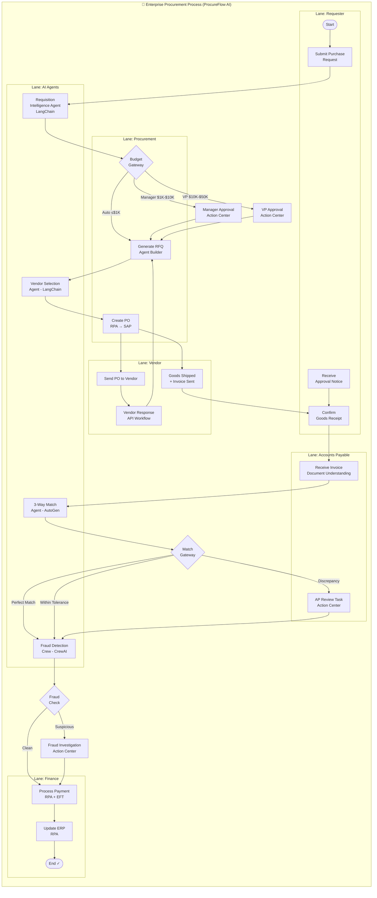
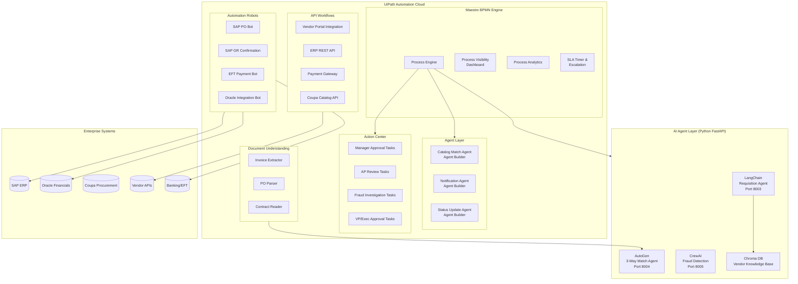
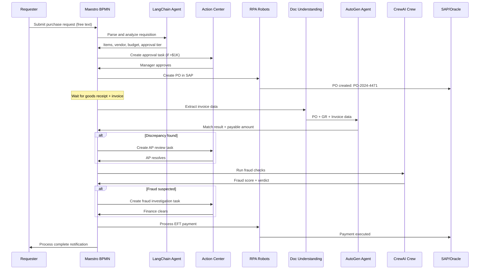
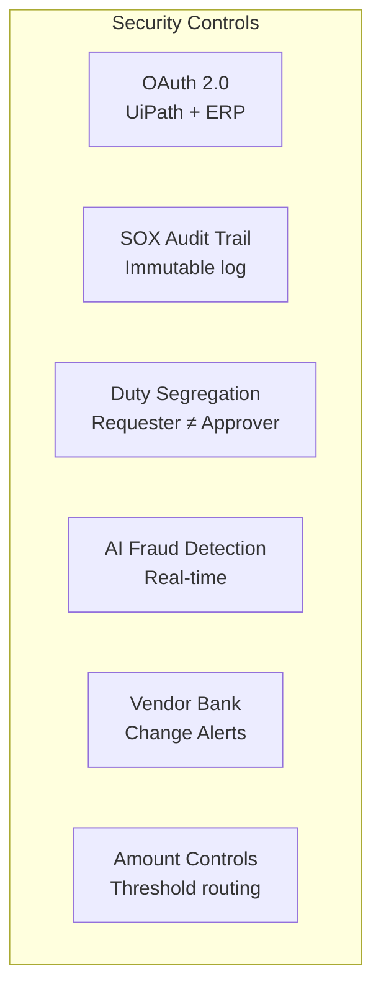

# Architecture — ProcureFlow AI
## Track 2: UiPath Maestro BPMN

---

## BPMN 2.0 Process Overview

---

## System Architecture

---

## Data Flow

---

## BPMN 2.0 Patterns Used

| Pattern | Usage | Location in Flow |
|---------|-------|-----------------|
| **Exclusive Gateway (XOR)** | Budget threshold routing | After requisition processing |
| **Exclusive Gateway (XOR)** | Match result routing | After 3-way match |
| **Exclusive Gateway (XOR)** | Fraud check routing | After fraud analysis |
| **Service Task** | All AI agent calls | Throughout |
| **User Task** | All human approvals | Action Center tasks |
| **Parallel Gateway** | (ERP update + notification) | Final payment phase |
| **Timer Event** | SLA escalation (48h approval) | Approval tasks |
| **Error Boundary Event** | Agent failure handling | All agent tasks |
| **Compensation Task** | PO cancellation on fraud | Fraud path |

---

## Security Design

---

## Scalability

- **Horizontal:** Multiple BPMN process instances — thousands of concurrent POs
- **Async agents:** AI agents called asynchronously — BPMN doesn't block waiting
- **Queue-based:** Approval tasks distributed across available approvers
- **Idempotent:** All RPA actions are idempotent — safe to retry on failure
- **Stateless AI agents:** FastAPI containers auto-scale based on load
