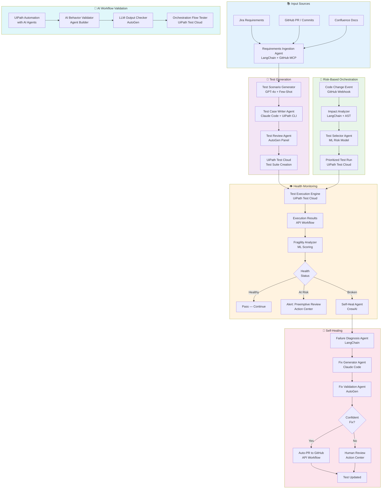

# 🏆 TestGen AI Sentinel — Autonomous Testing Intelligence Platform

> *From manual test writing to self-healing AI-driven quality assurance in one platform*

[](https://opensource.org/licenses/MIT)
[](https://cloud.uipath.com)
[](https://uipath-agenthack.devpost.com)

---

## 🎯 Problem

Software testing is the last frontier of enterprise automation — and it's failing:

- **80% of QA budget** is spent maintaining existing tests, not creating new ones
- **60%** of automation breaks within 6 months of deployment due to UI/API changes
- **1 in 3 releases** ship with critical bugs because test coverage was incomplete
- **Average 3 weeks** to write comprehensive test coverage for a new feature
- **Test debt** accumulates silently — teams discover broken automation in production
- No one knows which tests are fragile until they fail in CI/CD at 2am
- AI-infused workflows introduce **non-deterministic behavior** that traditional testing can't handle

The result: QA teams are trapped in a cycle of reactive firefighting instead of proactive quality engineering.

---

## 💡 Solution

**TestGen AI Sentinel** is an autonomous testing intelligence platform orchestrated by **UiPath Test Cloud**. It uses AI agents to generate, validate, execute, monitor, and self-heal test automation across enterprise applications — turning requirements into running tests and broken tests into fixed tests, with minimal human intervention.

### What makes it different:
- **Requirement-to-Test AI** — Reads Jira stories, Confluence requirements, and GitHub PRs → automatically generates meaningful test scenarios and UiPath test cases
- **Test Health Monitor** — Continuously analyzes test execution history to identify fragile, flaky, and at-risk tests BEFORE they fail in production
- **Self-Healing Automation** — When a test breaks due to a UI change or API update, an AI agent diagnoses the failure, proposes a fix, and submits a PR
- **Risk-Based Test Orchestration** — Dynamically selects which tests to run based on code change impact, historical failure rates, and business criticality
- **AI Workflow Validation** — Tests AI-infused automations by validating agent reasoning, LLM output quality, and orchestration flow correctness
- **UiPath for Coding Agents Integration** — Claude Code generates new test automation code on demand

---

## 🏗️ Architecture



### Component Breakdown

| Component | Technology | Responsibility |
|-----------|-----------|----------------|
| Requirements Ingestion | LangChain + GitHub MCP | Parse Jira/GitHub/Confluence for test scenarios |
| Test Generator | GPT-4o + Few-Shot | Generate BDD test scenarios from requirements |
| Test Writer | Claude Code + UiPath CLI | Write executable UiPath test automation |
| Test Reviewer | AutoGen | Multi-agent review panel for test quality |
| Test Orchestrator | UiPath Test Cloud | Execute, schedule, and manage test suites |
| Health Monitor | ML Scoring Model | Predict test fragility from execution history |
| Self-Heal Engine | CrewAI (3 agents) | Diagnose, fix, and validate broken tests |
| Risk Analyzer | LangChain + AST Parser | Determine test impact from code changes |
| AI Validator | Agent Builder | Validate AI/LLM behavior within automations |

---

## 🚀 Key Features

### 1. Requirement-to-Test Automation
- Connects to Jira, Confluence, and GitHub via API Workflows
- LangChain agent reads acceptance criteria and generates BDD test scenarios
- Claude Code converts scenarios into executable UiPath test automation
- Automated PR creation with test code ready for review
- Demonstrates UiPath for Coding Agents (BONUS POINTS)

### 2. Continuous Test Health Monitoring
- Tracks execution history, failure rates, and selector stability
- ML model predicts fragility score for each test (0-100)
- Dashboard shows "tests at risk" before they fail
- Proactive alerts to QA teams via Action Center tasks
- Integration with team communication (webhook notifications)

### 3. Self-Healing Test Automation
- When a test fails, the Failure Diagnosis Agent analyzes root cause
  - UI selector change → suggests updated XPath/CSS
  - API response change → suggests updated assertions
  - Timing issue → suggests dynamic wait strategies
- Fix Generator Agent (Claude Code) writes the corrected test
- AutoGen review panel validates the fix logic
- High-confidence fixes auto-PR; uncertain fixes go to human review

### 4. Risk-Based Test Orchestration
- GitHub webhook triggers on every PR and commit
- AST parser identifies which code modules changed
- ML model maps code changes to affected tests
- Only runs tests relevant to the change (10x faster CI/CD)
- Maintains minimum coverage guarantees

### 5. AI Workflow Validation
- Tests UiPath automations that include AI agents and LLMs
- Validates agent reasoning chains (not just final outputs)
- Non-determinism testing with statistical sampling
- Contract testing for external AI service integrations
- Regression detection when LLM provider changes

### 6. Comprehensive Reporting
- Test coverage by feature, module, and risk tier
- Trend analysis: improving vs deteriorating test suites
- ROI dashboard: tests auto-generated, bugs caught, hours saved
- Compliance reporting for audit and release gates

---

## 🛠️ Tech Stack

| Technology | Purpose | Why Chosen |
|------------|---------|------------|
| **UiPath Test Cloud** | Test execution, management, orchestration | Core platform — scheduled runs, results, reporting |
| **UiPath Agent Builder** | Monitoring agents, notification agents | Rapid agent development for status updates |
| **UiPath API Workflows** | GitHub, Jira, Confluence integrations | Serverless webhook handling |
| **UiPath Action Center** | Human review for uncertain fixes | Approval workflows with context |
| **UiPath for Coding Agents** | Test code generation via Claude Code | BONUS: AI writes test automation |
| **LangChain + GPT-4o** | Requirements parsing, impact analysis | Tool calling, structured output |
| **Claude Code** | Test automation code generation | Best-in-class code generation |
| **AutoGen** | Test review panel, fix validation | Multi-agent conversation for quality assurance |
| **CrewAI** | Self-healing crew (diagnose + fix + validate) | Parallel specialized agents |
| **scikit-learn** | Test fragility ML model | Lightweight, interpretable prediction |
| **Python FastAPI** | Coded agent backend | REST API for all AI services |
| **GitHub Actions** | CI/CD integration | Webhook source, test result comments |

---

## 📸 Screenshots / Demo

📹 **Demo Video:** [Link to YouTube Demo]

### Platform Screenshots
1. Requirements ingestion: Jira story → generated test scenarios (side-by-side)
2. Claude Code writing test automation in real-time (UiPath for Coding Agents)
3. Test health dashboard with fragility scores
4. Self-healing agent diagnosing and fixing a broken test
5. Risk-based run: only 23 of 847 tests ran on a targeted PR
6. AI workflow validation: LLM output validation in action

---

## 🏃 Getting Started

### Prerequisites
- UiPath Automation Cloud account with Test Cloud enabled (Labs access)
- Python 3.11+
- Node.js 18+
- GitHub repository (for integration)
- Jira Cloud or Server instance
- OpenAI API key + Anthropic API key (for Claude Code)

### Setup Instructions

#### 1. Clone the repository
```bash
git clone https://github.com/your-team/testgen-ai-sentinel
cd testgen-ai-sentinel
```

#### 2. Install UiPath CLI (for coding agent integration)
```bash
npm install -g @uipath/cli
uipath auth login
```

#### 3. Configure Python environment
```bash
cd src/agents
pip install -r requirements.txt
cp .env.example .env
# Configure all API keys and UiPath cloud credentials
```

#### 4. Train the fragility prediction model
```bash
python src/ml/train_fragility_model.py --historical-data data/test_history.csv
```

#### 5. Deploy AI agents to UiPath
```bash
uipath deploy src/agents/test_generator_agent
uipath deploy src/agents/self_heal_agent
uipath deploy src/agents/risk_analyzer_agent
```

#### 6. Configure GitHub webhook
- Repository Settings → Webhooks → Add webhook
- URL: `https://your-uipath-cloud.api/webhooks/github-push`
- Events: Push, Pull Request

#### 7. Configure Jira integration
- Import API Workflow: `src/api-workflows/jira-integration.yaml`
- Set Jira credentials in UiPath Cloud connections

#### 8. Import test suites and run demo
```bash
python tests/demo_requirement_to_test.py --jira-story DEMO-123
python tests/demo_self_healing.py --break-test selector_change
python tests/demo_risk_based_run.py --pr-number 42
```

---

## 🤖 UiPath Components Used

- ✅ **UiPath Test Cloud** — Core test execution, management, and reporting
- ✅ **UiPath Agent Builder** — Health monitoring and notification agents
- ✅ **UiPath API Workflows** — GitHub, Jira, Confluence integrations
- ✅ **UiPath Action Center** — Human review for uncertain test fixes
- ✅ **UiPath Automation Cloud Robots** — Legacy test environment automation
- ✅ **UiPath for Coding Agents** — Claude Code writes test automation via UiPath CLI

## 🧠 External Frameworks

- ✅ **LangChain** — Requirements parsing, impact analysis, diagnosis
- ✅ **AutoGen** — Multi-agent test review and fix validation
- ✅ **CrewAI** — Self-healing crew with 3 specialized agents
- ✅ **scikit-learn** — Test fragility prediction ML model

---

## 👥 Team

| Name | Role |
|------|------|
| [Your Name] | Solution Architect & UiPath Developer |

---

## 📄 License

MIT License — see [LICENSE](LICENSE) file.
