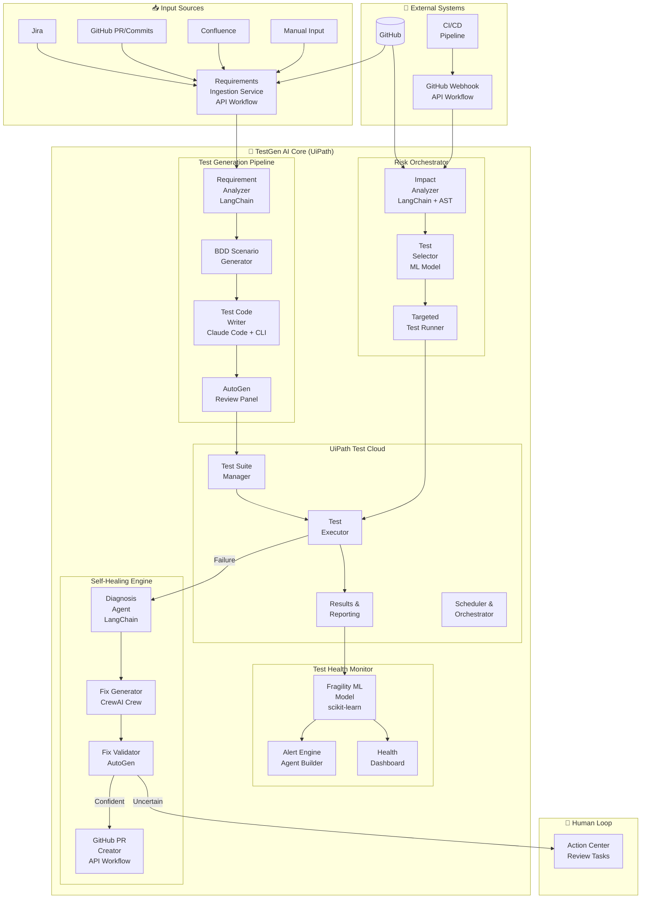
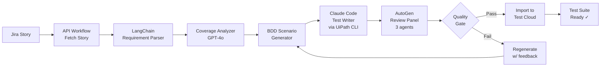
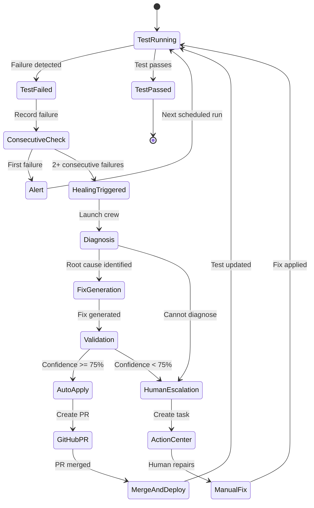
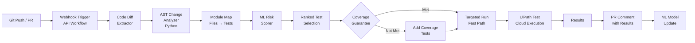
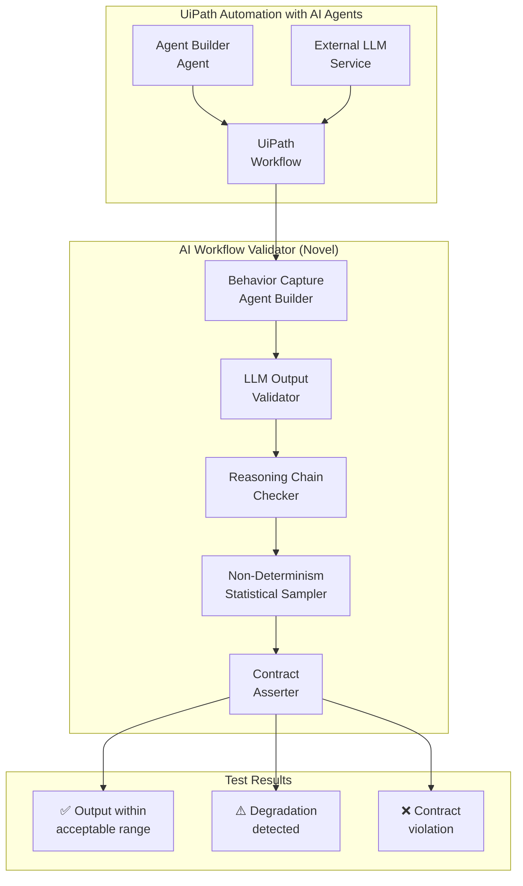

# Architecture — TestGen AI Sentinel
## Track 3: UiPath Test Cloud

---

## High-Level System Architecture

---

## Test Generation Pipeline

---

## Self-Healing Flow

---

## Risk-Based Test Orchestration

---

## AI Workflow Validation (Novel Feature)

This is the unique capability for testing AI-infused UiPath workflows — validating that LLM-based agents produce correct, consistent outputs even when they're non-deterministic.

---

## ML Fragility Model

The test fragility prediction uses a gradient boosting model trained on:

| Feature | Description |
|---------|-------------|
| `failure_rate_30d` | Failures in last 30 days |
| `selector_type` | ID (unstable) vs text vs XPath (stable) |
| `avg_execution_time` | Growing execution time = instability signal |
| `days_since_last_update` | Old tests tend to drift |
| `deploy_correlation` | Tests that fail after deploys |
| `page_load_dependency` | Tests sensitive to dynamic loading |
| `flakiness_score` | Pass/fail inconsistency |
| `dom_depth` | Deep DOM selectors are more brittle |

**Output:** Fragility score 0-100 (>70 = at-risk, >85 = likely to fail within 7 days)

---

## Security Design

- All API calls authenticated with UiPath Cloud OAuth 2.0
- GitHub token scoped to minimum permissions (read PR + write PR comments)
- Auto-applied fixes never touch production — always through PR review
- Test code sandboxed — no access to production data
- Jira/Confluence access read-only via service account
